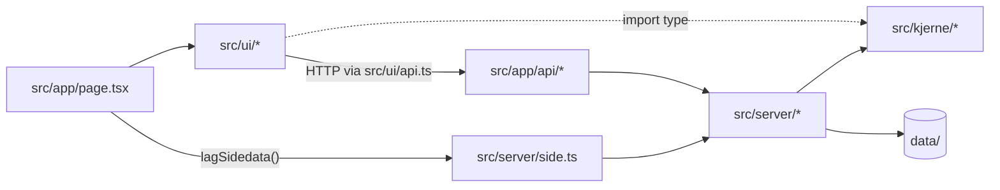
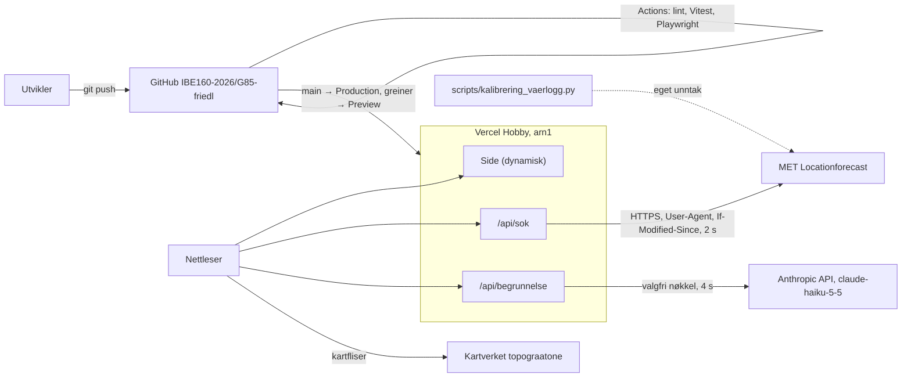
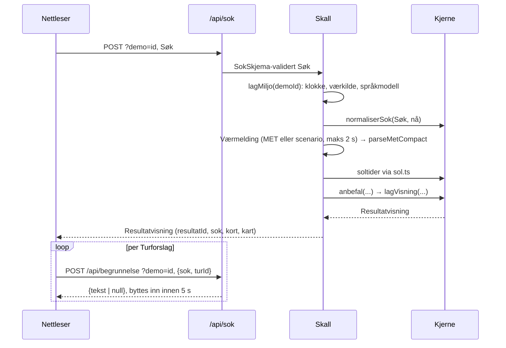

# Architecture Spine — Turplanlegger

Begrepene fra PRD §3 brukes ordrett. Begrunnelsen for valgene står i [.memlog.md](.memlog.md), og gjennomgangene står i [reviews/](reviews/).

## Design Paradigm

**Functional core, imperative shell.** Reglene og alt som skal vises, lages av rene funksjoner i kjernen. Sideeffekter ligger i skallet. Visningen viser bare det den får.

| Lag | Mappe | Inneholder | Får ikke |
| --- | --- | --- | --- |
| Kjerne | `src/kjerne/` | Søk-skjema, normalisering, Værmelding-parsing, Værklasse, Turtid, filtrering, rangering, variasjon, Mørkevarsel, Bedre tidsvindu, sol, tid, formatering, Regeltekst, kontroll av Språkmodelltekst, visningsmodell, Zod-skjemaer | `fetch`, `Date.now()`, `new Date()` uten argument, `process.env`, fil-I/O, Next.js, React |
| Skall | `src/server/` | miljø (klokke, værkilde, språkmodell), MET-adapter og cache, scenarioregister, språkmodell-adapter, lasting av data, sidedata, orkestrering | regler fra FR-6–FR-22 |
| API | `src/app/api/` | tynne route handlers: les `demo`, valider, kall skallet, returner JSON | logikk utover det |
| Visning | `src/app/` (side), `src/ui/` | komponenter, klientstate, `src/ui/api.ts` | regne ut, formatere eller tidssonejustere domeneverdier |



Pilene er de eneste lovlige avhengighetene. Kjernen bruker bare rene biblioteker (`date-fns`, `@date-fns/tz`, `zod`).

## Invariants & Rules

### AD-1 — Avhengigheter peker innover [ADOPTED]

- **Binds:** all kode i `src/`; NFR-2
- **Prevents:** at regler havner i UI-et eller i route handlers, og at kjernen trenger nettverk eller klokke i test
- **Rule:** Avhengighetene følger diagrammet. Kjernen får alt som argumenter. ESLint håndhever dette med `@typescript-eslint/no-restricted-imports`:
  - Visningen kan importere fra `src/kjerne/` bare med `allowTypeImports`.
  - Bare `page.tsx` kan importere fra skallet, og bare `src/server/side.ts` (AD-18).
  - I `src/kjerne/` er `fetch`, `Date.now`, `process` og argumentløs `new Date()` forbudt med `no-restricted-globals` og `no-restricted-syntax`.

### AD-2 — Regelmotoren kjører bare på serveren, og det finnes ingen lagret tilstand [ADOPTED]

- **Binds:** FR-6–FR-22, NFR-5, NFR-6
- **Prevents:** to implementasjoner av reglene, og tilstand som overlever et Søk
- **Rule:** `POST /api/sok` tar et Søk og returnerer en Resultatvisning (AD-3). Nettleseren regner aldri ut en regel. «Finn tur», «Bruk Bedre tidsvindu» og «Prøv igjen» sender et Søk til samme endepunkt. Det finnes ingen database, ingen kontoer og ingen lagring på serveren utover MET-cachen. Søket og Resultatet lever bare i klientens minne og står aldri i URL-en.

### AD-3 — Visningsmodellen er ett Zod-skjema i kjernen [ADOPTED]

- **Binds:** FR-6, FR-10–FR-24, FR-29; alle tilstander og komponenter i EXPERIENCE.md
- **Prevents:** at server og UI finner opp hver sin kontrakt, og at UI-et utleder eller formaterer selv
- **Rule:** `src/kjerne/visning/skjema.ts` er skjemaet for alt `/api/sok` returnerer. Den første storyen skriver det, før noen UI-story starter. Skjemaet inneholder:
  - `resultatId`, `sok` (normalisert, AD-17), `justering?` (tekst), `overskrift`, `dittSok`, `liveTekst`
  - `vaer`: `vurdert` (Værklasse, symbol `{ ord, ikonSti }`, ferdige tekster for verdier og Tidsvindu, Høydemerknad, eventuell Værvarsling med utløsende verdi først) eller `mangler` (tekst)
  - `utfall`: diskriminert på `type`, med `turforslag` (1–3 kort), `kortesteTur` og `fraradet`. Varianten følger cellene i FR-6.
  - hvert kort: `turId`, `kriterier` for Tid, Vær, Ønsker og Mørke med `{ merke: 'ok' | 'se-opp' | 'ingen', tekst, detalj }`, stolpeandeler mellom 0 og 1, Regeltekst, faktalinje, Kartinfoboks-tekst, Stokkoversikt-rad, kilde `{ navn, url }` og kart `{ rute: GeoJSON Feature, startpunkt: { lat, lon }, nummer }`
  - `bedreTidsvindu`: `funnet` med `nyttSok` (et komplett Søk) og ferdige tekster, `ingen` med tekst, eller fraværende

  UI-et viser strenger, andeler og flagg, og bygger aldri et Søk av et tidspunkt. Ingen snake_case-felt fra Turdatasettet går ut av skallet. Trengs et nytt felt, utvides skjemaet. En kontrakttest validerer svaret fra `/api/sok` mot skjemaet for hver demo-ID.

### AD-4 — Serveren eier «nå» [ADOPTED]

- **Binds:** FR-1, FR-2, FR-19, FR-21, NFR-2, NFR-11
- **Prevents:** at skjemaet, normaliseringen og reglene bruker hver sin klokke
- **Rule:** Klokka leses bare i `src/server/miljo.ts`. Siden får «nå» og skjemavalgene gjennom AD-18. Hvert Søk regnes med serverens «nå» for kallet (AD-17). Nettleserens klokke brukes aldri til domenelogikk.

### AD-5 — Miljøet bygges på ett sted fra demo-ID-en [ADOPTED]

- **Binds:** NFR-3, NFR-11, FR-13, FR-22, SM-2, SM-3
- **Prevents:** blandet tilstand, som fast «nå» med ekte MET, demo som stille faller tilbake til live, og flere lister over gyldige ID-er
- **Rule:**
  - Demo-ID-en reiser bare som query-parameteren `demo`, både på sidens URL og på API-URL-ene. Klienten gjør alle kall gjennom `src/ui/api.ts`, som kopierer `demo` fra `location.search`. Historikkendringer beholder `?demo`.
  - `lesDemoId(url)` og `lagMiljo(demoId)` i `src/server/miljo.ts` er det eneste stedet som velger klokke, værkilde og språkmodell.
  - Gyldige demo-ID-er er nøklene i scenarioregisteret `src/server/vaer/scenarioer.ts` (AD-13).
  - Alle forespørselsskjemaer er `.strict()`.

  | Modus | Klokke | Værkilde | Språkmodell | Turdatasett |
  | --- | --- | --- | --- | --- |
  | ingen demo | systemklokke | MET (AD-6) | Claude hvis nøkkelen er satt, ellers av | `data/turer-moldemarka.json` |
  | gyldig demo | scenarioets faste «nå» | scenarioet | falsk | samme |
  | ukjent demo | – | – | – | – |

  En ukjent demo-ID gir `{ feil: 'ukjent-demo', gyldigeDemoIder }`, både ved sidevisning (AD-18) og som 400 fra API-et. Demo-merket vises når og bare når miljøet er en demo.

### AD-6 — MET kalles bare fra én adapter [ADOPTED]

- **Binds:** FR-7, FR-13, NFR-4, NFR-5
- **Prevents:** flere MET-kall med ulik User-Agent, cache eller tidsgrense, og at demo-data havner i cachen for live-brukere
- **Rule:** `src/server/vaer/met.ts` er det eneste stedet i appen som kaller `api.met.no`. Adapteren følger disse reglene:
  - HTTPS, `compact`, Værpunktet fra `src/kjerne/vaerpunkt.ts` med trunkerte fire desimaler og `altitude=400`.
  - User-Agent `turplanlegger-ibe160/<versjon> https://github.com/IBE160-2026/G85-friedl`.
  - Svaret tolkes fra `response.status` (200 eller 304).
  - Cache i minnet, `VaerCache`, med nøkkel (lat, lon, altitude). Den er asynkron og har ett pågående kall per nøkkel. Innenfor `Expires` gjøres ingen kall. Etter `Expires` fornyes cachen med `If-Modified-Since` lik forrige `Last-Modified`, og svaret 304 forlenger levetiden.
  - Tidsgrensen er 2 s. Ved feil eller tidsavbrudd blir Værmeldingen `null` (FR-13), og utløpt data brukes ikke.
  - Bare `met.ts` bruker `VaerCache`.

  Kalibreringsskriptet er et navngitt unntak med egen User-Agent (AD-8).

### AD-7 — Tid og formatering har hver sin modul i kjernen [ADOPTED]

- **Binds:** FR-1, FR-2, FR-7, FR-9, FR-14, FR-19–FR-22, NFR-8
- **Prevents:** sommertidsfeil, døgn med feil lengde, og ulike tall i Regeltekst og UI
- **Rule:**
  - `src/kjerne/tid.ts` er den eneste modulen som importerer `@date-fns/tz`. Veggklokke-logikk går gjennom den: Turdag, kvarter, hele timer og `timerITidsvindu(start, slutt)` (halvåpent intervall, en time teller når den overlapper).
  - Øyeblikk sendes mellom funksjoner som epoke-ms i UTC.
  - `src/kjerne/format.ts` lager all tekst med klokkeslett, datoer, varigheter, lengder og værverdier.

### AD-8 — Terskler og Værord har én kilde [ADOPTED]

- **Binds:** FR-8, FR-20, NFR-10; PRD §10 spm. 1
- **Prevents:** at tersklene i appen og i kalibreringsskriptet glir fra hverandre, og at Værord-båndene ligger igjen på gamle tall etter kalibreringen
- **Rule:**
  - `data/vaerterskler.json` har formen `{ versjon: 1, klasser: [{ klasse: 'fraradet' | 'darlig' | 'middels', nedbor_mm_t_minst, vind_ms_minst, temp_c_under }] }`, med strengeste klasse først. Grensene sammenlignes med `>=` for nedbør og vind og `<` for temperatur, og `null` betyr ingen grense.
  - Zod i kjernen avviser ukjente nøkler.
  - `src/kjerne/vaerord.ts` eier bare grensene under laveste terskel (0,1 mm/t og 5,5 m/s). Båndene fra middels og opp hentes fra tersklene.
  - `testdata/vaerklasse-fasit.json` (timer → klasse og Tidsvindu → klasse) kjøres av Vitest og av `scripts/kalibrering_vaerlogg.py --selvtest`.
  - Fra 2026-11-17, etter loggeuka, leser skriptet tersklene fra JSON-fila. Skriptet kaller MET selv med User-Agent `turplanlegger-ibe160-kalibrering/<versjon> …` og uten cache.

### AD-9 — Turdatasettet har én fil og ett skjema [ADOPTED]

- **Binds:** FR-14–FR-18, FR-26, FR-27, NFR-2
- **Prevents:** at lasting og validering er uenige om hva en gyldig Tur er, og at testene velter når Turene endres
- **Rule:**
  - `data/turer-moldemarka.json` er Turdatasettet appen bruker, også i Demomodus.
  - `src/kjerne/turdata/skjema.ts` (Zod) bruker feltnavnene fra fila uendret. Både skallet og FR-27-testen bruker skjemaet.
  - Andre formater lages fra JSON-fila og lagres ikke.
  - `testdata/turer.json` er en fast kopi som bare regeltestene bruker (AD-16).
  - `mal_punkt: { lat, lon, koordinatkilde }` er valgfritt per Tur. Visningsmodellen har `kart.malpunkt` bare når feltet finnes, og kartet tegner Mål-trekanten og Mål i tegnforklaringen bare da.

### AD-10 — Rutegeometri slås sammen på serveren [ADOPTED]

- **Binds:** FR-23–FR-25, FR-27, FR-28
- **Prevents:** at Rutesegmenter slås opp på ulik nøkkel, og forvekslet koordinatrekkefølge
- **Rule:**
  - `scripts/konverter-rutegeometri.ts` konverterer GML i EPSG:25833 til `data/rutegeometri.geojson` i WGS84, med ett objekt per Rutesegment nøklet på rutenummer og rutenavn. Fila committes.
  - Bare skallet leser den, og den legger Omtrentlig rute per Tur inn i visningsmodellen som GeoJSON `Feature` med `MultiLineString` i `[lon, lat]`.
  - Punkter er `{ lat, lon }`.
  - Nettleseren slår aldri opp Rutesegmenter.

### AD-11 — Solberegningen er vår egen [ADOPTED]

- **Binds:** FR-19, FR-21
- **Prevents:** at et bibliotek med en annen definisjon snur Mørkevarsel-eksemplene (suncalc 1.9.0 gir 16:02 i stedet for 15:59), og at «i morgen» tolkes ulikt
- **Rule:**
  - `src/kjerne/sol.ts` bruker NOAA med senitvinkel 90,833°, havnivå og Værpunktet, og runder av til hele minutter. Den testes mot addendumets kontrollverdier med ±2 min.
  - Regelfunksjonene får `soltider: Record<'YYYY-MM-DD' (Oslo), { oppUtc, nedUtc }>` for Turdagen, og når Turdag er i dag, også for i morgen. Orkestreringen bygger objektet, og en dato som mangler, er en feil.

### AD-12 — Språkmodellteksten kommer i et eget kall som serveren eier [ADOPTED]

- **Binds:** FR-20, FR-22, NFR-3, NFR-5, §6
- **Prevents:** at språkmodellen påvirker utvalget, en åpen proxy til Claude, gamle svar på nye kort, og ulik kontroll av svaret
- **Rule:**
  - Klienten sender `POST /api/begrunnelse?demo=…` med `{ sok, turId }` for hvert Turforslag, ikke for den korteste Turen. Serveren regner ut Regeltekst og fakta om Turen selv, med en fast liste over felt. Klienten sender aldri tekst.
  - Svaret er `{ tekst: string | null }`. Klienten bytter det inn bare hvis kortet med samme `resultatId` og `turId` fortsatt vises og det har gått under 5 s siden Resultatet ble vist (`AbortController`).
  - `src/server/sprakmodell/claude.ts` er det eneste stedet som kaller Anthropic: `@anthropic-ai/sdk`, `claude-haiku-5-5`, `timeout: 4000`, `maxRetries: 0`, `thinking: { type: 'disabled' }`, `output_config: { effort: 'low' }`. Den sender ikke `temperature`, `top_p` eller `top_k`. Tekst leses fra blokker av `type: 'text'`, og et svar med `stop_reason` lik `refusal` eller `max_tokens` gir `null`.
  - Svaret godtas bare hvis den rene funksjonen `kontrollerSprakmodelltekst()` i `src/kjerne/begrunnelse/` godkjenner det.
  - `src/server/sprakmodell/falsk.ts` lager en deterministisk omskriving av Regelteksten som består kontrollen.

### AD-13 — Værscenarioer er MET-svar på fil, felles for tester og Demomodus [ADOPTED]

- **Binds:** NFR-2, NFR-11, SM-2, SM-3
- **Prevents:** at tester og demo bruker ulike værdata, og at viktige tilstander ikke kan nås i UI-et
- **Rule:**
  - Hvert scenario ligger i `data/vaerscenarioer/<id>/` med `met.json` (MET `compact`, én desimal) og `scenario.json` (`na` som ISO 8601 med tidssoneforskyvning og en `beskrivelse`). I stedet for `met.json` kan scenarioet ha `"vaer": "mangler"`.
  - Scenarioene er `uj-1`, `uj-2`, `uj-3`, `uten-vaer` og `ingen-bedre`.
  - `src/server/vaer/scenarioer.ts` importerer dem statisk og er registeret.
  - Scenariokilden bruker samme `parseMetCompact` som MET-adapteren (AD-19), men importerer ikke `met.ts` og bruker ingen cache.

### AD-14 — Hosting, bygg og hemmeligheter [ADOPTED]

- **Binds:** NFR-3, NFR-5, NFR-7, SM-3
- **Prevents:** en app som bare virker med gruppens kontoer, et bygg som fryser «nå», data som mangler i deployen, og nøkler i repoet
- **Rule:**
  - Prosjektet lages med `create-next-app@16.4.3 --ts --app --src-dir --no-tailwind --eslint --no-react-compiler --no-cache-components --import-alias "@/*" --use-npm --no-agents-md` i en tom mappe og flyttes inn i repoet. `"use cache"` brukes ikke, og siden rendres dynamisk.
  - Filer i `data/` leses med statiske importer, aldri med `fs` og dynamiske stier.
  - Hosting er Vercel Hobby med funksjonsregion `arn1` i `vercel.json`. `main` går til Production og andre greiner til Preview. Node 26.x er pinnet i `engines`.
  - Den eneste miljøvariabelen er `ANTHROPIC_API_KEY`, og den er valgfri. Den settes bare for Production, og bare under test og demo, med lav utgiftsgrense. `.env.example` committes, `.env` gjør det ikke.
  - Lokalt kjører appen med `npm install && npm run dev` uten nøkler.
  - Den første lockfila lages med `npm install --before=2026-10-29` og committes.
  - GitHub Actions kjører lint, Vitest og Playwright ved hver push. Kan ikke Vercel kobles direkte til organisasjonen, deployer Actions med `vercel deploy --prebuilt` og `VERCEL_TOKEN`.

### AD-15 — Kartet rendres bare i nettleseren [ADOPTED]

- **Binds:** FR-23–FR-25, FR-29, NFR-1, NFR-6; EXPERIENCE.md › Foundation
- **Prevents:** Leaflet på serveren, ruter i feil hav, ulike løsninger for Kartutsnitt, og ikoner og fonter fra eksterne tjenester
- **Rule:**
  - Siden importerer klientkomponenten `src/ui/KartLaster.tsx` (`'use client'`), som laster kartet med `next/dynamic` og `ssr: false` og importerer `leaflet/dist/leaflet.css`.
  - Ruter tegnes bare med react-leaflet sin `<GeoJSON>`.
  - Kartutsnitt på kortene er samme kartkomponent uten interaksjon.
  - Bakgrunnen er `https://cache.kartverket.no/v1/wmts/1.0.0/topograatone/default/webmercator/{z}/{y}/{x}.png` med «© Kartverket» som lenke (CC BY 4.0). `tileerror` gir tilstanden «Bakgrunnskartet kunne ikke lastes.».
  - Kreditering: «Data fra MET Norway» med lenke (FR-29).
  - METs værikoner (MIT) ligger med `LICENSE` i `public/vaerikoner/`.
  - Nunito Sans selvhostes med `next/font`.
  - Nettleseren kontakter bare vår egen server og Kartverket.

### AD-16 — Testene er delt mellom kjerne og visning [ADOPTED]

- **Binds:** SM-2, NFR-2, FR-27
- **Prevents:** at regler bare testes gjennom UI-et, og at UI-testene velter når Turene endres
- **Rule:**
  - Hver regelkonsekvens i FR-8–FR-21 er en Vitest-test mot kjernen, med `testdata/turer.json` og Værscenarioene. Navngitte eksempler fra brukerreisene og fra FR-16–FR-21 testes bare her.
  - FR-27-testen validerer `data/turer-moldemarka.json`.
  - Visningskonsekvensene, med alle radene i FR-6, er Playwright-tester mot `?demo=<id>`. De sjekker tilstand, antall og felt, men aldri navn på Turer.
  - Ingen test kaller MET eller Anthropic.

### AD-17 — Søk-kontrakten og normaliseringen eies av kjernen [ADOPTED]

- **Binds:** FR-1–FR-6, FR-19; EXPERIENCE.md (passert Starttidspunkt, «Endre søk», «Prøv igjen»)
- **Prevents:** relativ og absolutt Turdag om hverandre (feil rundt midnatt), etiketter mot koder, og at passert tid gir 400 eller blir rundet ulikt
- **Rule:**
  - `src/kjerne/sok.ts` eksporterer det eneste `SokSkjema` (`.strict()`): `{ dato: 'YYYY-MM-DD' (Oslo), start: 'HH:MM', tilgjengeligMin: 15–300 i steg på 15, vanskelighetsgrad: 'G' | 'B' | 'R', utsikt: boolean, vann: boolean }`.
  - `normaliserSok(sok, na)` i kjernen er den eneste justeringen. Et passert Starttidspunkt rundes opp til neste kvarter. Etter 22:00 blir Søket i morgen kl. 10:00. En dato som verken er i dag eller i morgen, blir standard-Søket.
  - `/api/sok` normaliserer alltid og svarer aldri 400 for passert tid. Visningsmodellen har med det normaliserte `sok` og `justering?` («Flyttet til 14:15, fordi 13:30 har passert.»).
  - «Endre søk», «Prøv igjen» og Ditt søk bruker bare `resultat.sok`.

### AD-18 — Siden får sine data fra én funksjon i skallet [ADOPTED]

- **Binds:** FR-1–FR-5, FR-23, NFR-11; EXPERIENCE.md › Søk-kartet og Demo-merket
- **Prevents:** `new Date()` i `page.tsx`, et ekstra endepunkt for standardverdier, og en side som ignorerer `?demo`
- **Rule:** `src/app/page.tsx` kaller bare `lagSidedata(demoId)` fra `src/server/side.ts`. Den returnerer ett av to:
  - `{ demo: { id, beskrivelse, naTekst } | null, skjema, startpunkter, telletekst }`. `skjema` har valgene for begge Turdagene med etikett og om valget er låst, og standard-Søket.
  - `{ feil: 'ukjent-demo', gyldigeDemoIder }`.

  Velger brukeren «I dag» på nytt, settes standardverdien fra `skjema`. Tid som har passert etter sidevisningen, håndteres av AD-17.

### AD-19 — Værmeldingen har én form og én parser [ADOPTED]

- **Binds:** FR-7–FR-13, FR-19
- **Prevents:** timer nøklet i Oslo-tid mot UTC, timer som mangler eller blir doble i døgn med 25 timer, og ulik behandling av hull
- **Rule:**
  - `parseMetCompact(json)` i `src/kjerne/vaer/met-compact.ts` er ren og validerer med Zod. Den returnerer `Vaermelding = { timer: { startUtc, tempC, vindMs, nedborMmT, symbolKode | null }[] }`, stigende og bare med rader som har `next_1_hours`.
  - Timene i et Tidsvindu velges med `timerITidsvindu` (AD-7).
  - Mangler én av timene, er Værklassen for det vinduet `mangler`. For Søket gjelder da FR-13, og i letingen etter Bedre tidsvindu hoppes vinduet over.

## Consistency Conventions

| Concern | Convention |
| --- | --- |
| Navn | Begrepene fra PRD §3 på bokmål, uten æøå i identifikatorer (`turforslag`, `vaerklasse`, `morkevarsel`). camelCase for verdier, PascalCase for typer og komponenter. |
| Filer | kebab-case `.ts` og PascalCase `.tsx`. Tester ligger ved siden av koden som `*.test.ts`. Playwright-tester ligger i `e2e/`. |
| Datafelt | snake_case finnes bare i `data/` og i laster og skjema i skallet og kjernen. API-et er camelCase. |
| Tid over API | Visningstekst er ferdig formatert. Søk bruker `dato` og `start` (AD-17). Andre maskinlesbare tidspunkter er ISO 8601 med tidssoneforskyvning. |
| Feil | Svaret er `{ feil: 'ukjent-demo', gyldigeDemoIder }` eller `{ feil: 'ugyldig-sok', detaljer }` med 400, og 500 for alt annet. Klienten velger visning ut fra `feil`. Ugyldig Søk og 500 gir Kontaktfeil-kortet. Feil hos MET og språkmodellen gir aldri HTTP-feil. Klientens tidsgrense er 10 s. |
| Logging | `console.error` for adapterfeil. Forespørsler logges aldri. Ingen analyseverktøy. |
| Klientstate | Ett Søk og én Resultatvisning i React-state på siden. Et Resultat legger til én historikkoppføring, og Tilbake går til Søk med verdiene. |
| Styling | CSS Modules. Tokens fra DESIGN.md ligger som CSS-variabler i `src/ui/tokens.css`. Ikke Tailwind. |
| Faste UI-tekster | Tekster uten domeneverdier står ordrett fra EXPERIENCE.md i `src/ui/tekster.ts`, sammen med lenker som MET sine farevarsler. Tekst med domeneverdier lages i kjernen. |

## Stack

| Name | Version |
| --- | --- |
| Node.js (Vercel og lokalt) | 26.x |
| TypeScript | 5.9.3 |
| @types/node | 26.6.6 |
| Next.js (App Router, create-next-app) | 16.4.3 |
| React / React DOM | 19.3.1 |
| Leaflet | 1.9.4 |
| react-leaflet | 5.0.0 |
| zod | 4.6.7 |
| date-fns | 4.4.0 |
| @date-fns/tz | 1.5.0 |
| @anthropic-ai/sdk | 1.3.0 |
| proj4 (bare i skriptet) | 2.22.0 |
| Vitest | 5.0.5 |
| Vite (dev, peer av Vitest) | 8.3.5 |
| @playwright/test | 1.64.1 |
| Claude-modell | `claude-haiku-5-5` |
| Hosting | Vercel Hobby, region `arn1` |

Dette er den nyeste patchen som var minst 14 dager gammel 2026-11-12, kontrollert med `npm audit`. Når koden finnes, er det `package-lock.json` som gjelder.

## Structural Seed

### Drift og eksterne tjenester



### Ett Søk



### Kildetre

```text
src/
  kjerne/            # ren TypeScript (AD-1)
    sok.ts           # SokSkjema, normaliserSok (AD-17)
    vaerpunkt.ts     # Værpunktets koordinat og høyde
    vaer/            # met-compact.ts, Værklasse (AD-19)
    turdata/         # Zod-skjema for Tur (AD-9)
    begrunnelse/     # Regeltekst, kontroll av Språkmodelltekst (AD-12)
    visning/         # skjema.ts og lagVisning (AD-3)
    tid.ts           # eneste bruker av @date-fns/tz (AD-7)
    format.ts        # all formatering (AD-7)
    sol.ts           # NOAA (AD-11)
    vaerord.ts       # grenser under laveste terskel (AD-8)
  server/
    miljo.ts         # lesDemoId, lagMiljo, klokke (AD-4, AD-5)
    side.ts          # lagSidedata (AD-18)
    sok.ts           # orkestrerer ett Søk
    vaer/            # met.ts, cache, scenarioer.ts (AD-6, AD-13)
    sprakmodell/     # claude.ts, falsk.ts (AD-12)
  app/
    page.tsx
    api/sok/route.ts
    api/begrunnelse/route.ts
  ui/                # komponenter, KartLaster.tsx, api.ts, tokens.css, tekster.ts
data/
  turer-moldemarka.json
  rutegeometri.geojson
  vaerterskler.json
  vaerscenarioer/    # uj-1, uj-2, uj-3, uten-vaer, ingen-bedre
  raw/
testdata/            # turer.json, vaerklasse-fasit.json
scripts/             # konverter-rutegeometri.ts, kalibrering_vaerlogg.py
public/vaerikoner/   # METs ikoner og LICENSE
e2e/
vercel.json          # regions: ["arn1"]
```

## Capability → Architecture Map

| Capability / Area | Lives in | Governed by |
| --- | --- | --- |
| Søk-skjema, standardverdier (FR-1–FR-5) | `src/kjerne/sok.ts`, `src/server/side.ts`, `src/ui/` | AD-4, AD-17, AD-18 |
| Sende Søk, resultattabell (FR-6) | `/api/sok`, `src/server/sok.ts`, `src/kjerne/visning/` | AD-2, AD-3, AD-17 |
| Hente Værmelding (FR-7, FR-13) | `src/server/vaer/`, `src/kjerne/vaer/` | AD-5, AD-6, AD-13, AD-19 |
| Værklasse, sammendrag, Værvarsling, frarådet (FR-8–FR-12) | `src/kjerne/vaer/`, `data/vaerterskler.json` | AD-3, AD-8, AD-19 |
| Turtid, filtrering, rangering, variasjon, korteste Tur (FR-14–FR-18) | `src/kjerne/` | AD-1, AD-9 |
| Bedre tidsvindu, Mørkevarsel (FR-19, FR-21) | `src/kjerne/`, `src/kjerne/sol.ts` | AD-3, AD-7, AD-11, AD-17, AD-19 |
| Regeltekst (FR-20) | `src/kjerne/begrunnelse/`, `src/kjerne/vaerord.ts` | AD-7, AD-8 |
| Språkmodelltekst (FR-22) | `/api/begrunnelse`, `src/server/sprakmodell/` | AD-12 |
| Kart (FR-23–FR-25) | `src/ui/KartLaster.tsx`, kartdata i visningsmodellen | AD-3, AD-10, AD-15 |
| Turdatasett og validering (FR-26, FR-27) | `data/`, `src/kjerne/turdata/` | AD-9, AD-16 |
| Rutegeometri (FR-28) | `scripts/konverter-rutegeometri.ts` | AD-10 |
| Kreditering (FR-29) | `src/ui/` | AD-15 |
| Responsivt, tilgjengelighet, språk (NFR-1, NFR-8, NFR-9) | `src/ui/` | DESIGN.md, EXPERIENCE.md, AD-3 |
| Testbarhet, Demomodus (NFR-2, NFR-11) | `testdata/`, `data/vaerscenarioer/`, `src/server/miljo.ts` | AD-5, AD-13, AD-16 |
| Kjørbar, hemmeligheter (NFR-3, NFR-7) | README, `.env.example`, Vercel | AD-14 |
| MET-vilkår (NFR-4) | `src/server/vaer/met.ts` | AD-6 |
| Ytelse (NFR-5) | `/api/sok`, `/api/begrunnelse`, `arn1` | AD-2, AD-6, AD-12, AD-14 |
| Personvern (NFR-6) | hele appen | AD-2, AD-15, konvensjonen for logging |
| Justerbare terskler (NFR-10) | `data/vaerterskler.json` | AD-8 |

## Open Questions

| # | Spørsmål | Eier | Inntil avklart |
| --- | --- | --- | --- |
| 1 | Kan Vercel-appen installeres på GitHub-organisasjonen IBE160-2026, eller må org-eieren godkjenne den? Må sjekkes før den første deploy-storyen. | gruppa og faglærer | Reserven i AD-14 (deploy fra Actions) |

## Deferred

| Hva | Hvorfor det kan vente | Tas opp igjen når |
| --- | --- | --- |
| Delt MET-cache (Vercel Runtime Cache, Redis) | Cachen per instans er nok ved MVP-trafikk. `VaerCache` er allerede asynkron. | MET svarer 429, eller trafikken øker |
| Rate limiting av `/api/begrunnelse` | Nøkkelen er bare satt under test og demo, med utgiftsgrense | Nøkkelen skal stå på permanent |
| Utløpt Værmelding når MET feiler | FR-13 er enkel og testbar | Brukertester viser at «Været er ikke vurdert.» kommer for ofte |
| Komponentstrukturen i UI-et | DESIGN.md og EXPERIENCE.md eier den, og AD-3 eier dataene | – |
| Overvåking utover Vercels logger | Ingen drift etter kurset | Appen skal leve etter IBE160 |
| Eget domene | Vercels adresse holder | – |
| Værmelding per Tur | Utenfor MVP (PRD §8.2) | §8.2 tas inn |
| Rekkefølgen på epics | `bmad-create-epics-and-stories`, med nivåene i PRD §8.1. AD-3 og AD-17 må komme først | Neste steg |
